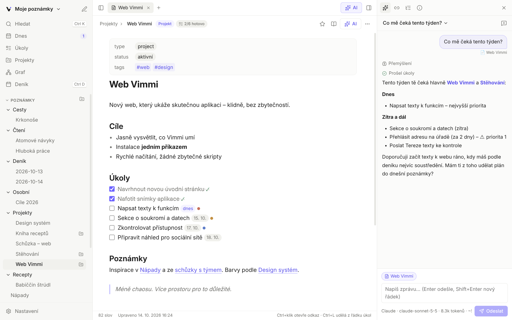
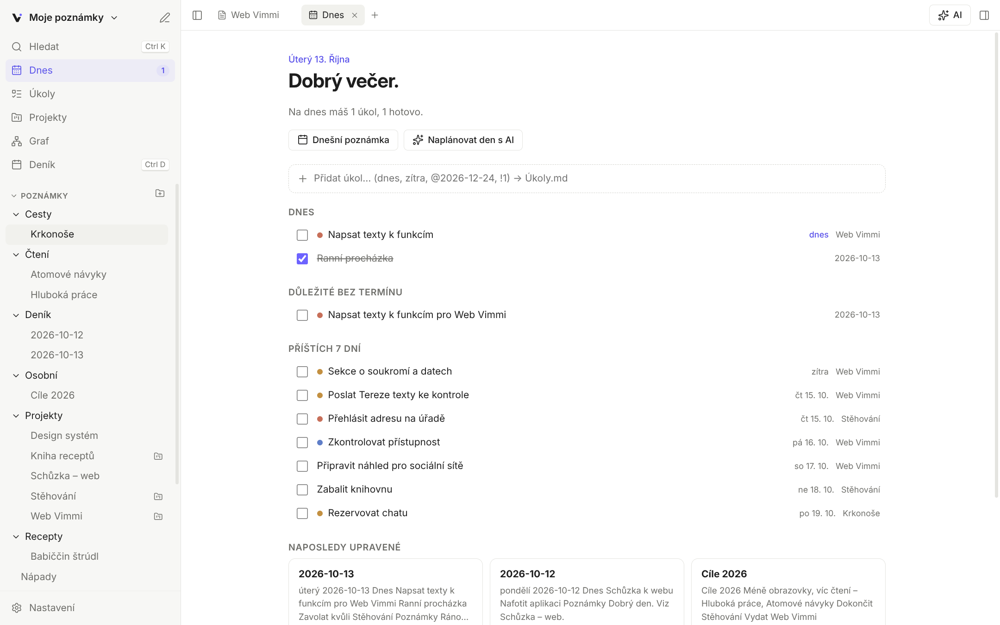
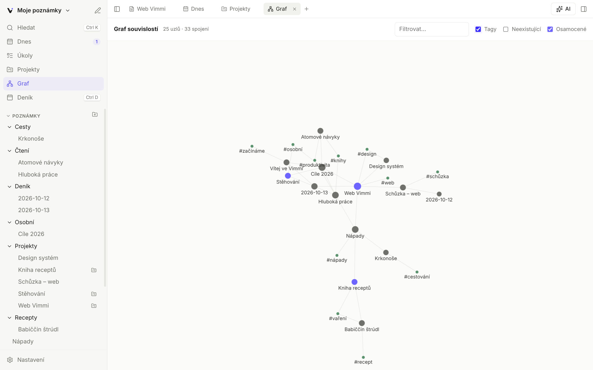
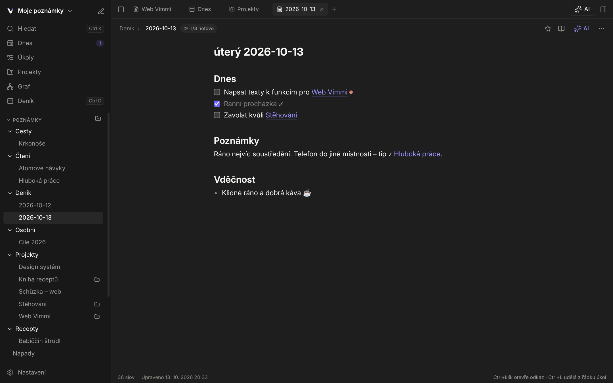

<p align="center">
  
</p>

<h1 align="center">Vimmi</h1>

<p align="center"><strong>Všechno důležité. Na jednom místě.</strong><br>
Poznámky, úkoly a projekty v jednom klidném prostoru – s AI asistentem.</p>

<p align="center"><a href="https://gerchanisko.github.io/vimmi/">Web</a> · <a href="https://gerchanisko.github.io/vimmi-app/">Otevřít v prohlížeči</a> · <a href="#instalace">Instalace</a> · <a href="#synchronizace">Synchronizace</a> · <a href="#funkce">Funkce</a> · <a href="#ai-poskytovatelé">AI</a></p>

Poznámky jsou obyčejné soubory Markdown ve složce (trezoru), takže jsou vždycky tvoje a funguje to i s trezorem z Obsidianu. AI asistent (Claude, OpenRouter, OpenAI, Gemini nebo lokální Ollama) umí v poznámkách hledat, shrnovat, plánovat a rovnou je upravovat.



## Instalace

### Linux (Ubuntu, Debian, Mint, Arch, Manjaro, Fedora, openSUSE…)

Stačí jeden příkaz v terminálu:

```bash
curl -fsSL https://raw.githubusercontent.com/gerchanisko/vimmi-app/main/install.sh | bash
```

Skript si sám:
- doinstaluje chybějící nástroje (`git`, `curl`…) přes správce balíčků tvé distribuce (apt, pacman, dnf, zypper),
- použije systémový Node.js 22+, nebo stáhne oficiální Node.js jen pro Vimmi (do systému nezasahuje),
- stáhne zdrojáky, sestaví aplikaci a přidá **Vimmi do nabídky aplikací** – odtud si ji připneš na panel,
- na Ubuntu 24.04+ přidá AppArmor profil, který Electron aplikace potřebují.

Vše se instaluje do domovské složky (`~/.local/opt/vimmi`); `sudo` se použije jen pro systémové balíčky a AppArmor.

- **Aktualizace:** spusť stejný příkaz znovu.
- **Odinstalace:** `curl -fsSL https://raw.githubusercontent.com/gerchanisko/vimmi-app/main/install.sh | bash -s -- --uninstall` (poznámky a nastavení zůstanou).
- **Ze stažených zdrojáků:** `git clone https://github.com/gerchanisko/vimmi-app && cd vimmi-app && ./install.sh`

### Windows 10 a 11

Stáhni instalátor **[Vimmi-Setup.exe](https://github.com/gerchanisko/vimmi-app/releases/latest/download/Vimmi-Setup.exe)** a spusť ho. Vimmi pak najdeš v nabídce Start a na ploše.

Instalátor zatím není digitálně podepsaný, takže Windows může zobrazit modré okno SmartScreen – klikni na **Další informace → Přesto spustit**. Aktualizace: stáhni a spusť novější instalátor. Odinstalace: *Nastavení → Aplikace → Vimmi*.

### iPhone, iPad a Android (webová aplikace)

Otevři **<https://gerchanisko.github.io/vimmi-app/>** v Safari (na Androidu v Chrome), klepni na **Sdílet → Přidat na plochu**. Vimmi pak běží jako aplikace přes celou obrazovku, funguje i offline a poznámky se ukládají v zařízení. S počítačem je propojíš přes [synchronizaci](#synchronizace).

### macOS

Připravujeme. Do té doby funguje webová aplikace.

## Aktualizace

Vimmi se aktualizuje samo (od verze 0.2.2):

- **Windows** a **Linux AppImage** stáhnou novou verzi z GitHub Releases na pozadí a nainstalují ji po restartu.
- **Linux z instalačního skriptu** spustí instalaci nové verze na pozadí a pak nabídne restart.
- **Webová aplikace** (iPhone, Android) se obnoví na novou verzi při příštím návratu do aplikace.

Ručně: *Nastavení → O aplikaci → Zkontrolovat aktualizace*. Tamtéž se dají automatické aktualizace vypnout.

## Synchronizace

Poznámky se synchronizují přes **soukromý repozitář na tvém GitHubu** – mezi počítači, telefonem i tabletem. Zdarma, s celou historií změn a bez dalšího účtu.

1. Vytvoř soukromý repozitář, např. [`vimmi-poznamky`](https://github.com/new?name=vimmi-poznamky&visibility=private).
2. Vytvoř [token](https://github.com/settings/personal-access-tokens/new) s přístupem jen k tomuto repozitáři a oprávněním *Contents: Read and write*.
3. Ve Vimmi otevři **Nastavení → Synchronizace**, vlož token a repozitář a zapni synchronizaci. Totéž na dalších zařízeních.

Synchronizuje se automaticky při spuštění, chvíli po úpravě, každou minutu a při návratu do aplikace. Když stejnou poznámku upravíš na dvou zařízeních zároveň, nic se neztratí – druhá verze se uloží vedle jako „…(konflikt zařízení datum)“. Smazané poznámky jdou do koše. Token je na počítači zašifrovaný v systémové klíčence, v prohlížeči se ukládá v úložišti daného zařízení.

## Snímky

| Dnes | Graf souvislostí | Tmavý vzhled |
| --- | --- | --- |
|  |  |  |

## Funkce

**Poznámky**
- Editor Markdownu s živým náhledem (značky se schovají mimo řádek, na kterém píšeš), zvýrazněním kódu, hledáním v poznámce a volitelným Vim režimem
- Odkazy `[[Poznámka]]`, `[[Poznámka|text]]`, `[[Poznámka#Nadpis]]` s doplňováním; klik na neexistující odkaz poznámku vytvoří
- Tagy `#tag` i vnořené `#projekt/web`, tagy ve frontmatter
- Zpětné odkazy, nepropojené zmínky, související poznámky, osnova, vlastnosti
- Režim čtení s klikacími úkoly, export do PDF
- Vkládání obrázků ze schránky nebo přetažením (ukládají se do složky příloh), `![[obrázek.png]]`
- Přejmenování a přesun (i přetažením ve stromu) automaticky opraví odkazy ve všech poznámkách
- Koš (`.trash` v trezoru), záložky, karty, šablony (`{{date}}`, `{{time}}`, `{{title}}`, `{{weekday}}`), denní poznámky
- Změny souborů z jiných programů se projeví okamžitě

**Úkoly a projekty**
- Úkol je řádek `- [ ] text` v jakékoliv poznámce, termín `@2026-10-14`, priorita `!1`–`!3` (kompatibilní i s emoji formátem Obsidian Tasks)
- Přehled **Dnes**: po termínu, dnes, důležité, příštích 7 dní, naposledy upravené
- Přehled **Úkoly** s filtry a seskupením podle poznámky, termínu nebo priority; rychlé přidání úkolu („zítra !1“)
- **Kalendář** jako Google Kalendář: měsíc, týden, den a seznam; události přetáhneš na jiný čas nebo den, natáhneš jejich délku, mohou se opakovat a připomenout se upozorněním. Každá událost je obyčejná poznámka ve složce `Kalendář/` (`type: event`, `date`, `start`, `end`), takže se synchronizuje a funguje i v Obsidianu. Úkoly s termínem jsou v kalendáři taky. Stačí AI napsat „zítra v 10 mám doktora“.
- **Projekty**: poznámka s `type: project`, poznámky k projektu přes `project: Název`; postup, další úkoly, propojené poznámky

**Hledání a navigace**
- Ctrl+K: hledání v názvech i obsahu bez ohledu na diakritiku, filtry Vše / Poznámky / Úkoly / Projekty, vytvoření poznámky
- Ctrl+P: paleta všech příkazů (fuzzy hledání)
- Fulltextové hledání s filtry `#tag` a `path:složka`
- Graf souvislostí (celý trezor nebo okolí poznámky, tagy, neexistující odkazy, přiblížení a tažení)

**AI asistent (Claude)**
- Chat, který vidí otevřenou poznámku a výběr a pomocí nástrojů umí v trezoru hledat, číst poznámky, procházet úkoly, projekty, tagy, souvislosti, deník a kalendář (přidat, přesunout nebo smazat událost)
- Umí vytvářet a upravovat poznámky, přidávat a odškrtávat úkoly, přejmenovávat a mazat. Ve výchozím stavu zapisuje rovnou; v Nastavení → AI lze zapnout „Ptát se“, pak každou změnu nejdřív ukáže jako rozdíl a čeká na schválení
- Rychlé akce nad výběrem nebo celou poznámkou: shrnout, vylepšit, opravit pravopis, zkrátit, rozvést, pokračovat v psaní, vytáhnout úkoly, osnova, vysvětlit, přeložit, navrhnout název a tagy, vlastní pokyn
- Volitelné hledání na webu, zobrazení přemýšlení, vlastní pokyny, historie chatů (ukládá se v `.vimmi/chats` v trezoru), odhad ceny
- Výběr poskytovatele AI (viz níže), rychlé přepnutí přímo v chatu, načtení aktuálního seznamu modelů

## AI: poskytovatelé

| Poskytovatel | API | Poznámka |
| --- | --- | --- |
| **Claude (Anthropic)** – doporučeno | Anthropic SDK, Messages API | Výchozí, Claude Sonnet 5.5. Přemýšlení, hledání na webu, prompt caching, záložní model při odmítnutí (`fallbacks: "default"`). |
| **OpenAI** | OpenAI SDK, Responses API | GPT-6.x. Nástroje, přemýšlení, hledání na webu; bezstavově (`store: false`). |
| **Google Gemini** | OpenAI-kompatibilní endpoint | Flash modely mají bezplatnou úroveň. Klíč z Google AI Studia. |
| **OpenRouter** – doporučeno | OpenAI-kompatibilní | Stovky modelů jedním klíčem, modely `:free` zdarma (s limity). |
| **Ollama** | OpenAI-kompatibilní, lokálně | Zdarma, poznámky neopustí počítač. Model musí podporovat nástroje (tools). |
| **Vlastní** | OpenAI Chat Completions | LM Studio, vLLM, Groq, Mistral, DeepSeek… s vlastní adresou serveru. |

- Klíče se zadávají v **Nastavení → AI**, každý poskytovatel má vlastní. Ukládají se zašifrovaně přes systémovou klíčenku (Electron `safeStorage`) a nikdy se nedostanou do okna aplikace; všechna volání API probíhají v hlavním procesu.
- Pro vývoj fungují proměnné `ANTHROPIC_API_KEY`, `OPENAI_API_KEY`, `GEMINI_API_KEY`, `OPENROUTER_API_KEY` a `VIMMI_<POSKYTOVATEL>_BASE_URL` pro jiný server.
- Názvy modelů se často mění, proto tlačítko **Načíst modely** stáhne aktuální seznam přímo od poskytovatele.
- Nástroje AI jsou v [`shared/ai/tools.ts`](shared/ai/tools.ts) a sdílí je všichni poskytovatelé. Nový nástroj přidáš jedním záznamem `def({...})` se schématem v Zodu; u zapisujících nastavíš `write: true` a `preview`, aby šly schválit.
- Smyčky: Claude v [`shared/ai/agent.ts`](shared/ai/agent.ts), ostatní v [`shared/ai/openai-loops.ts`](shared/ai/openai-loops.ts). Když v rozběhnutém chatu změníš poskytovatele, konverzace se převezme jako text.

## Vývoj

Potřebuješ Node.js 22+.

```bash
npm install
npm run dev        # vývojový režim s automatickým načítáním
npm run dev:web    # webová aplikace v prohlížeči
npm run build:web  # webová aplikace (PWA) do dist-web/
npm start          # sestaví a spustí aplikaci
npm test           # unit testy (parser, trezor, AI nástroje)
npm run sync-e2e   # end-to-end test synchronizace: počítač ↔ telefon (webová verze) přes falešný GitHub
npm run smoke      # end-to-end test: spustí aplikaci, proklikne funkce, AI (Claude, OpenAI, kompatibilní) proti mock serverům
npm run install-desktop   # sestaví a nainstaluje do nabídky aplikací (po změnách v kódu)
npm run dist:win   # instalátor pro Windows do release/ (na Windows)
npm run dist:linux # AppImage pro Linux do release/
```

### Vydání

GitHub Actions ([`.github/workflows/release.yml`](.github/workflows/release.yml)) spouští unit i end-to-end testy na Windows a Linuxu. Při ručním spuštění nebo tagu `v*` sestaví `Vimmi-Setup.exe` a `Vimmi.AppImage` a přiloží je k vydání podle verze v `package.json`.

### Struktura

```
install.sh              instalační skript pro Linux
electron/main.ts        hlavní proces: okno, IPC, otevírání trezoru, deník, šablony, PDF
electron/preload.ts     bezpečné API pro okno (window.vimmi)
electron/node-storage.ts  úložiště trezoru na disku se sledováním změn
electron/settings.ts    nastavení a zašifrovaný API klíč
shared/providers.ts     seznam poskytovatelů, výchozí modely, adresy
shared/ai/tools.ts    nástroje pro práci s trezorem
shared/vault.ts         jádro trezoru nezávislé na úložišti (disk na počítači, IndexedDB v prohlížeči)
shared/sync.ts          synchronizace přes GitHub API (tříčestné porovnání, konflikty)
shared/ai/              AI asistent, nástroje a smyčky pro poskytovatele (běží v Electronu i v prohlížeči)
shared/                 parser Markdownu (odkazy, tagy, úkoly) a sdílené typy
web/                    webová aplikace: backend v prohlížeči, IndexedDB, manifest a service worker
src/                    rozhraní v Reactu (CodeMirror 6, markdown-it, d3-force)
test/                   unit testy (Vitest) a smoke test (Playwright + Electron)
```

## Licence

Vimmi je svobodný software pod licencí [GNU General Public License v3.0 nebo novější](LICENSE) (GPL-3.0-or-later). Můžeš ho používat, upravovat a šířit, ale upravené verze musí zůstat pod stejnou licencí a se zdrojovým kódem. Písmo Inter je pod licencí SIL Open Font License 1.1 (viz `src/assets/Inter-LICENSE.txt`).
