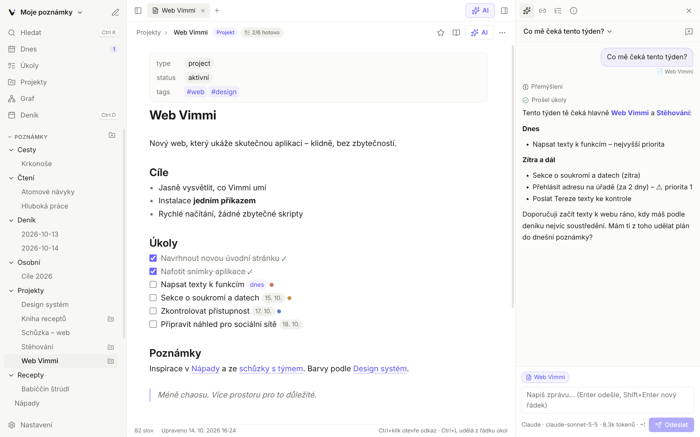
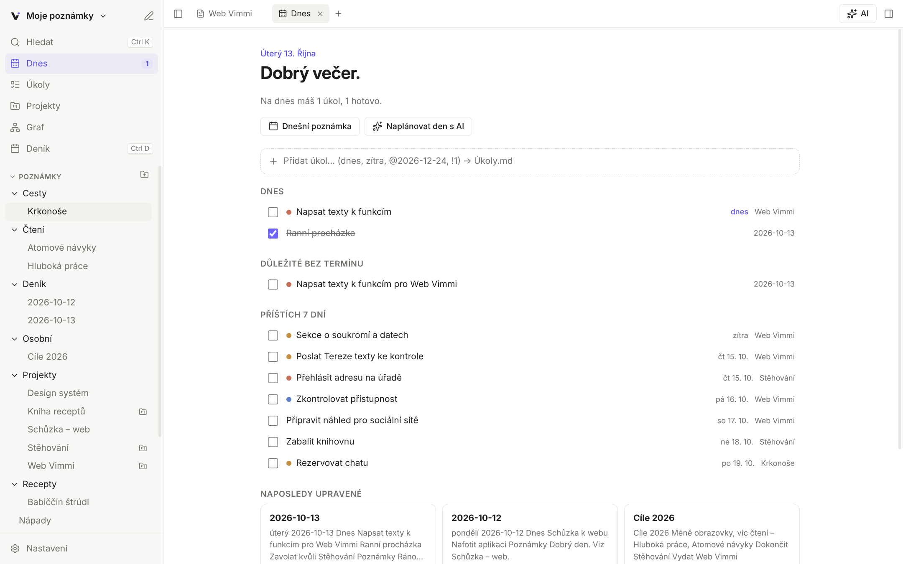
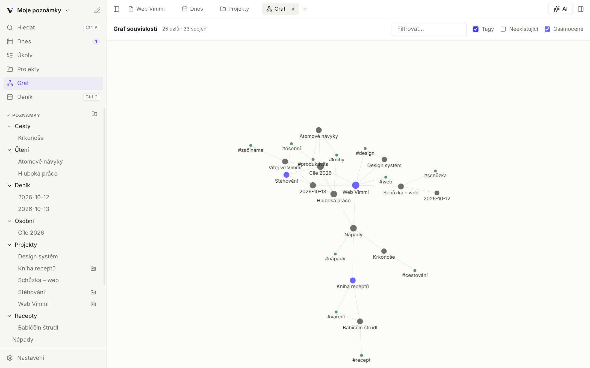
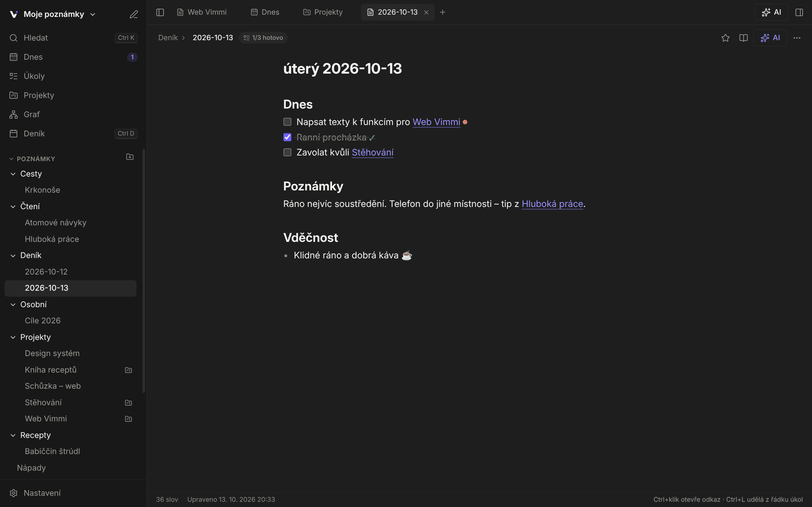

<p align="center">
  
</p>

<h1 align="center">Vimmi</h1>

<p align="center"><strong>Všechno důležité. Na jednom místě.</strong><br>
Poznámky, úkoly a projekty v jednom klidném prostoru – s AI asistentem.</p>

<p align="center"><a href="https://gerchanisko.github.io/vimmi/">Web</a> · <a href="https://gerchanisko.github.io/vimmi-app/">Otevřít v prohlížeči</a> · <a href="#instalace">Instalace</a> · <a href="#synchronizace">Synchronizace</a> · <a href="#funkce">Funkce</a> · <a href="#ai-poskytovatelé">AI</a></p>

Poznámky jsou obyčejné soubory Markdown ve složce (trezoru), takže jsou vždycky tvoje a funguje to i s trezorem z Obsidianu. AI asistent (Claude, Gemini, OpenRouter, OpenAI nebo lokální Ollama) umí v poznámkách hledat, shrnovat, plánovat a rovnou je upravovat.



## Instalace

### Linux (Ubuntu, Debian, Mint, Arch, Manjaro, Fedora, openSUSE…)

Stačí jeden příkaz v terminálu:

```bash
curl -fsSL https://raw.githubusercontent.com/gerchanisko/vimmi-app/main/install.sh | bash
```

Skript stáhne hotovou aplikaci z posledního vydání, ověří její kontrolní součet (SHA-256), rozbalí ji (není potřeba FUSE) a přidá **Vimmi do nabídky aplikací** – odtud si ji připneš na panel. Vše se instaluje do domovské složky (`~/.local/opt/vimmi`), bez `sudo`.

- **Aktualizace:** Vimmi se aktualizuje samo; ručně stačí spustit stejný příkaz znovu.
- **Odinstalace:** `curl -fsSL https://raw.githubusercontent.com/gerchanisko/vimmi-app/main/install.sh | bash -s -- --uninstall` (poznámky a nastavení zůstanou).

### Windows 10 a 11

Stáhni instalátor **[Vimmi-Setup.exe](https://github.com/gerchanisko/vimmi-app/releases/latest/download/Vimmi-Setup.exe)** a spusť ho. Vimmi pak najdeš v nabídce Start a na ploše.

Instalátor zatím není digitálně podepsaný, takže Windows může zobrazit modré okno SmartScreen – klikni na **Další informace → Přesto spustit**. Aktualizace: stáhni a spusť novější instalátor. Odinstalace: *Nastavení → Aplikace → Vimmi*.

### iPhone, iPad a Android (webová aplikace)

Otevři **<https://gerchanisko.github.io/vimmi-app/>** v Safari (na Androidu v Chrome), klepni na **Sdílet → Přidat na plochu**. Vimmi pak běží jako aplikace přes celou obrazovku, funguje i offline a poznámky se ukládají v zařízení. S počítačem je propojíš přes [synchronizaci](#synchronizace).

### macOS

Připravujeme. Do té doby funguje webová aplikace.

## Aktualizace

Vimmi se aktualizuje samo (od verze 0.2.2):

- **Windows** a **Linux AppImage** stáhnou novou verzi z GitHub Releases na pozadí a nainstalují ji po restartu.
- **Linux z instalačního skriptu** spustí instalaci nové verze na pozadí a pak nabídne restart.
- **Webová aplikace** (iPhone, Android) se obnoví na novou verzi při příštím návratu do aplikace.

Ručně: *Nastavení → O aplikaci → Zkontrolovat aktualizace*. Tamtéž se dají automatické aktualizace vypnout.

## Synchronizace

Poznámky se synchronizují přes **soukromý repozitář na tvém GitHubu** – mezi počítači, telefonem i tabletem. Zdarma, s celou historií změn a bez dalšího účtu.

1. Vytvoř soukromý repozitář, např. [`vimmi-poznamky`](https://github.com/new?name=vimmi-poznamky&visibility=private).
2. Vytvoř [token](https://github.com/settings/personal-access-tokens/new) s přístupem jen k tomuto repozitáři a oprávněním *Contents: Read and write*.
3. Ve Vimmi otevři **Nastavení → Synchronizace**, vlož token a repozitář a zapni synchronizaci. Totéž na dalších zařízeních.

Synchronizuje se automaticky při spuštění, každých 15 sekund a při návratu do aplikace (v klidu to je jen jeden krátký dotaz na GitHub). Když stejnou poznámku upravíš na dvou zařízeních zároveň, nic se neztratí – druhá verze se uloží vedle jako „…(konflikt zařízení datum)“. Smazané poznámky jdou do koše. Token je na počítači zašifrovaný v systémové klíčence, v prohlížeči se ukládá v úložišti daného zařízení.

## Snímky

| Dnes | Graf souvislostí | Tmavý vzhled |
| --- | --- | --- |
|  |  |  |

## Funkce

**Poznámky**
- Editor Markdownu s živým náhledem (značky se schovají mimo řádek, na kterém píšeš), zvýrazněním kódu, hledáním v poznámce a volitelným Vim režimem
- Odkazy `[[Poznámka]]`, `[[Poznámka|text]]`, `[[Poznámka#Nadpis]]` s doplňováním; klik na neexistující odkaz poznámku vytvoří
- Tagy `#tag` i vnořené `#projekt/web`, tagy ve frontmatter
- Zpětné odkazy, nepropojené zmínky, související poznámky, osnova, vlastnosti
- Režim čtení s klikacími úkoly, export do PDF
- Vkládání obrázků ze schránky nebo přetažením (ukládají se do složky příloh), `![[obrázek.png]]`
- Přejmenování a přesun (i přetažením ve stromu) automaticky opraví odkazy ve všech poznámkách
- Koš (`.trash` v trezoru), záložky, karty, šablony (`{{date}}`, `{{time}}`, `{{title}}`, `{{weekday}}`), denní poznámky
- Změny souborů z jiných programů se projeví okamžitě

**Úkoly a projekty**
- Úkol je řádek `- [ ] text` v jakékoliv poznámce, termín `@2026-10-14`, priorita `!1`–`!3` (kompatibilní i s emoji formátem Obsidian Tasks)
- Přehled **Dnes**: po termínu, dnes, důležité, příštích 7 dní, naposledy upravené
- Přehled **Úkoly** s filtry a seskupením podle poznámky, termínu nebo priority; rychlé přidání úkolu („zítra !1“)
- **Obrázky** přímo v poznámkách: vlož je ze schránky, přetažením nebo tlačítkem (na telefonu z galerie či fotoaparátu). V editoru se hned ukážou, kliknutím je otevřeš přes celou obrazovku. Velké fotky se při vložení zmenší (max. 2400 px), aby poznámky i synchronizace zůstaly rychlé. Ukládají se do složky `Přílohy/` jako ``, velikost změníš tažením za roh obrázku (dvojklik vrátí původní) – zapíše se jako ``, stejně jako v Obsidianu.
- **Historie verzí**: u každé poznámky (… → Historie verzí) vidíš starší verze, co se od nich změnilo, a jedním klikem je obnovíš. Vimmi si verzi ukládá při psaní (nejvýš jednou za 10 minut) a vždycky před úpravou od AI, před přepsáním synchronizací a před smazáním – takže jde vrátit i to, co pokazí AI. Se synchronizací přibude i dlouhodobá historie z GitHubu.
- **Kalendář** jako Google Kalendář: měsíc, týden, den a seznam; události přetáhneš na jiný čas nebo den, natáhneš jejich délku, mohou se opakovat a připomenout se upozorněním. Každá událost je obyčejná poznámka ve složce `Kalendář/` (`type: event`, `date`, `start`, `end`), takže se synchronizuje a funguje i v Obsidianu. Úkoly s termínem jsou v kalendáři taky. Stačí AI napsat „zítra v 10 mám doktora“. **Google Kalendář** (a jakýkoli jiný s adresou iCal) přidáš v Nastavení → Kalendář: aplikace na počítači ho stahuje každých 30 minut a telefon ho dostane přes synchronizaci. Jeho události vidíš v kalendáři, na stránce Dnes i v AI, jen pro čtení. Tajná adresa kalendáře zůstává jen v nastavení zařízení. Zobrazí se i jakýkoli importovaný soubor `.ics`. **Kalendář v telefonu** (Nastavení → Kalendář): Vimmi zveřejní tvoje události na tajném odkazu (soukromý GitHub Gist) a telefon ho odebírá ve svém Kalendáři – události i připomínky pak fungují i se zavřenou Vimmi. Token pro synchronizaci k tomu potřebuje navíc oprávnění „Gists: Read and write“.
- **Projekty**: poznámka s `type: project`, poznámky k projektu přes `project: Název`; postup, další úkoly, propojené poznámky

**Hledání a navigace**
- Ctrl+K: hledání v názvech i obsahu bez ohledu na diakritiku, filtry Vše / Poznámky / Úkoly / Projekty, vytvoření poznámky
- Ctrl+P: paleta všech příkazů (fuzzy hledání)
- Fulltextové hledání s filtry `#tag` a `path:složka`
- Graf souvislostí (celý trezor nebo okolí poznámky, tagy, neexistující odkazy, přiblížení a tažení)

**AI asistent (Claude)**
- Chat, který vidí otevřenou poznámku a výběr a pomocí nástrojů umí v trezoru hledat, číst poznámky, procházet úkoly, projekty, tagy, souvislosti, deník a kalendář (přidat, přesunout nebo smazat událost)
- Umí vytvářet a upravovat poznámky, přidávat a odškrtávat úkoly, přejmenovávat a mazat. Ve výchozím stavu zapisuje rovnou; v Nastavení → AI lze zapnout „Ptát se“, pak každou změnu nejdřív ukáže jako rozdíl a čeká na schválení
- Rychlé akce nad výběrem nebo celou poznámkou: shrnout, vylepšit, opravit pravopis, zkrátit, rozvést, pokračovat v psaní, vytáhnout úkoly, osnova, vysvětlit, přeložit, navrhnout název a tagy, vlastní pokyn
- Volitelné hledání na webu, zobrazení přemýšlení, vlastní pokyny, historie chatů (ukládá se v `.vimmi/chats` v trezoru), odhad ceny
- Výběr poskytovatele AI (viz níže), rychlé přepnutí přímo v chatu, načtení aktuálního seznamu modelů

## AI: poskytovatelé

| Poskytovatel | API | Poznámka |
| --- | --- | --- |
| **Claude (Anthropic)** – doporučeno | Anthropic SDK, Messages API | Výchozí, Claude Sonnet 5.5. Přemýšlení, hledání na webu, prompt caching, záložní model při odmítnutí (`fallbacks: "default"`). |
| **Google Gemini** – doporučeno zdarma | OpenAI-kompatibilní endpoint | Flash modely mají bezplatnou úroveň, dobře zvládají češtinu i nástroje a fungují i v telefonu. Klíč z Google AI Studia. |
| **OpenAI** | OpenAI SDK, Responses API | GPT-6.x. Nástroje, přemýšlení, hledání na webu; bezstavově (`store: false`). |
| **OpenRouter** | OpenAI-kompatibilní | Stovky modelů jedním klíčem, modely `:free` zdarma (s limity). |
| **Ollama** | OpenAI-kompatibilní, lokálně | Zdarma, poznámky neopustí počítač. Model musí podporovat nástroje (tools). |
| **Vlastní** | OpenAI Chat Completions | LM Studio, vLLM, Groq, Mistral, DeepSeek… s vlastní adresou serveru. |

- Klíče se zadávají v **Nastavení → AI**, každý poskytovatel má vlastní. Ukládají se v systémové klíčence (Secret Service na Linuxu, Správce pověření na Windows); bez klíčenky do souboru, který může číst jen tvůj uživatel. Do trezoru ani do nastavení se nikdy nedostanou.
- Pro vývoj fungují proměnné `ANTHROPIC_API_KEY`, `OPENAI_API_KEY`, `GEMINI_API_KEY`, `OPENROUTER_API_KEY` a `VIMMI_<POSKYTOVATEL>_BASE_URL` pro jiný server.
- Názvy modelů se často mění, proto tlačítko **Načíst modely** stáhne aktuální seznam přímo od poskytovatele.
- Nástroje AI jsou v [`shared/ai/tools.ts`](shared/ai/tools.ts) a sdílí je všichni poskytovatelé. Nový nástroj přidáš jedním záznamem `def({...})` se schématem v Zodu; u zapisujících nastavíš `write: true` a `preview`, aby šly schválit.
- Smyčky: Claude v [`shared/ai/agent.ts`](shared/ai/agent.ts), ostatní v [`shared/ai/openai-loops.ts`](shared/ai/openai-loops.ts). Když v rozběhnutém chatu změníš poskytovatele, konverzace se převezme jako text.

## Claude Pro / Max přes MCP (bez API klíče)

Máš předplatné Claude? Vimmi se dá připojit do **Claude Code** nebo **Claude Desktop** jako MCP server. Claude pak čte a upravuje tvoje poznámky, úkoly a kalendář a běží to na tvém předplatném, takže nepotřebuješ API klíč.

- **Přímo ve Vimmi: panel Claude Code** (ikona terminálu v pravém panelu). Vimmi v něm spustí tvůj nainstalovaný Claude Code ve složce trezoru, s nástroji Vimmi. Přihlašuješ se v něm sám svým účtem Claude a Vimmi do něj nevidí, je to jen terminál. Při prvním spuštění se Claude Code zeptá, jestli složce trezoru důvěřuješ: vyber *Yes, I trust this folder*. Potřebuje nainstalovaný Claude Code (`claude`).
- V aplikaci: **Nastavení → AI → Claude Pro / Max přes MCP** → *Přidat do Claude Code* nebo *Přidat do Claude Desktop* (Claude Desktop je pak potřeba restartovat).
- Ručně v terminálu (Linux s install.sh; na Windows je cesta `%LOCALAPPDATA%\Vimmi\vimmi.exe`):
  ```bash
  claude mcp add --scope user vimmi -- ~/.local/opt/vimmi/vimmi --mcp
  ```
- Jiný MCP klient: program Vimmi s parametrem `--mcp` (stdio).

Claude dostane stejné nástroje jako AI ve Vimmi (hledání, čtení, úpravy poznámek, úkoly, projekty, kalendář) a pracuje s trezorem, který máš ve Vimmi otevřený. Vimmi nemusí běžet. Každá změna se uloží do historie poznámky, takže jde vrátit. Na zápis se Claude Code ptá podle svého nastavení oprávnění. Vimmi se k tvému účtu Claude nepřihlašuje a nic od něj neukládá: Claude spouští Vimmi, ne naopak. AI přímo ve Vimmi dál používá API klíč. Protokol je v [`shared/ai/mcp.ts`](shared/ai/mcp.ts), spuštění v [`src-tauri/src/mcp.rs`](src-tauri/src/mcp.rs).

## Vývoj

Potřebuješ Node.js 22+ a Rust (stable). Na Linuxu ještě WebKitGTK 4.1 (`webkit2gtk-4.1` na Archu, `libwebkit2gtk-4.1-dev` na Ubuntu); pro end-to-end test `tauri-driver` (`cargo install tauri-driver`) a WebKitWebDriver.

```bash
npm install
npm run desktop:dev   # aplikace pro počítač ve vývojovém režimu
npm run dev:web       # webová aplikace v prohlížeči
npm run build:web     # webová aplikace (PWA) do dist-web/
npm test              # unit testy (parser, trezor, AI nástroje)
cargo test --manifest-path src-tauri/Cargo.toml   # testy Rustu (soubory, klíče, převzetí z Vimmi 0.7)
npm run desktop:test  # end-to-end test aplikace přes WebDriver: funkce, AI, synchronizace, aktualizace
node test/mcp-stdio.mjs  # MCP server (vimmi --mcp) přes stdin/stdout jako z Claude Code
npm run sync-e2e      # end-to-end test synchronizace: počítač ↔ telefon (webová verze) přes falešný GitHub
npm run desktop:build # instalátor / AppImage do src-tauri/target/release/bundle/
```

### Vydání

GitHub Actions ([`.github/workflows/release.yml`](.github/workflows/release.yml)) spouští unit i end-to-end testy (desktopová aplikace přes WebDriver, synchronizace počítač–telefon). Při ručním spuštění nebo tagu `v*` sestaví `Vimmi-Setup.exe` (Windows) a `Vimmi.AppImage` (Linux), na Windows ověří aktualizaci z Vimmi 0.7, a vydání doplní o `latest.json` (podepsané aktualizace), `latest.yml` (aktualizace z Electronu 0.7) a `SHA256SUMS`. Podepisovací klíč aktualizací je v tajném nastavení repozitáře `TAURI_SIGNING_PRIVATE_KEY`.

### Struktura

```
install.sh              instalační skript pro Linux
src-tauri/              aplikace pro počítač v Rustu (Tauri): okno, soubory trezoru, hlídání změn,
                        klíčenka, aktualizace, převzetí nastavení a klíčů z Vimmi 0.7
tauri/                  backend okna (window.vimmi) nad sdíleným jádrem a příkazy Rustu
electron/               původní aplikace v Electronu (do 0.7); API typy a ukázkový trezor sdílí i web
shared/providers.ts     seznam poskytovatelů, výchozí modely, adresy
shared/ai/tools.ts    nástroje pro práci s trezorem
shared/vault.ts         jádro trezoru nezávislé na úložišti (disk na počítači, IndexedDB v prohlížeči)
shared/sync.ts          synchronizace přes GitHub API (tříčestné porovnání, konflikty)
shared/ai/              AI asistent, nástroje a smyčky pro poskytovatele (běží v aplikaci i v prohlížeči)
shared/                 parser Markdownu (odkazy, tagy, úkoly) a sdílené typy
web/                    webová aplikace: backend v prohlížeči, IndexedDB, manifest a service worker
src/                    rozhraní v Reactu (CodeMirror 6, markdown-it, d3-force)
test/                   unit testy (Vitest), end-to-end test aplikace (tauri-smoke.mjs, WebDriver)
                        a synchronizace počítač–telefon (sync-e2e.mjs)
```

## Bezpečnost

Jak Vimmi chrání tvoje data a jak nahlásit chybu, najdeš v [SECURITY.md](SECURITY.md).

## Licence

Vimmi je svobodný software pod licencí [GNU General Public License v3.0 nebo novější](LICENSE) (GPL-3.0-or-later). Můžeš ho používat, upravovat a šířit, ale upravené verze musí zůstat pod stejnou licencí a se zdrojovým kódem. Písmo Inter je pod licencí SIL Open Font License 1.1 (viz `src/assets/Inter-LICENSE.txt`).
